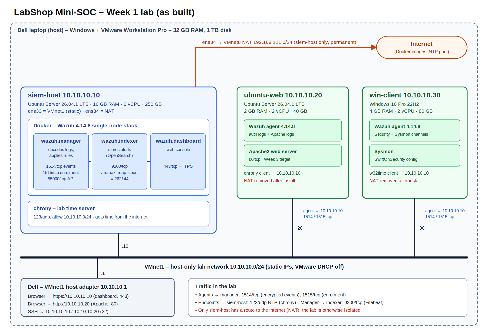
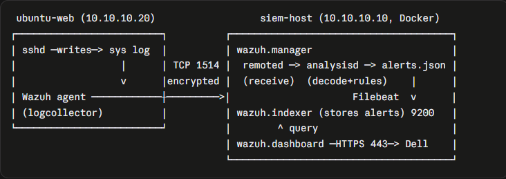

# Mini-SOC in a box – LabShop (Week 1)

LabShop is a small online shop with one web server and one staff PC and no
security monitoring. In Week 1 I built an isolated lab and deployed Wazuh as
the core of a small SOC that collects and analyses events from both machines.

## Architecture

Address table: [architecture/addresses.md](architecture/addresses.md)

| Machine | Role | OS | RAM | vCPU | Disk | IP (host-only) | NAT |
|---|---|---|---|---|---|---|---|
| siem-host | Wazuh in Docker, lab NTP server | Ubuntu Server 26.04.1 LTS | 16 GB | 6 | 250 GB | 10.10.10.10 | yes (permanent) |
| ubuntu-web | Linux endpoint, Apache web server | Ubuntu Server 26.04.1 LTS | 2 GB | 2 | 40 GB | 10.10.10.20 | removed |
| win-client | Windows endpoint, Sysmon | Windows 10 Pro 22H2 (19045) | 4 GB | 2 | 80 GB | 10.10.10.30 | removed |
| Dell (host) | Hypervisor, browser | Windows, VMware Workstation Pro | – | – | – | 10.10.10.1 | – |

## Versions

| Component | Version |
|---|---|
| Wazuh (manager, indexer, dashboard, agents) | **4.14.8** (wazuh-docker tag v4.14.8, single-node) |
| Docker Engine / Compose plugin | 29.9.0 / v5.6.0 (download.docker.com) |
| Sysmon | Sysinternals Sysmon64, SwiftOnSecurity sysmon-config |
| Hypervisor | VMware Workstation Pro 25.0.0 (build 24995812) |
| Windows licence / expiry | Windows 10 Pro, not activated (Notification mode) - no evaluation expiry, keeps working with an activation watermark (checked with `slmgr /xpr`) |

## How to start the lab (order matters)

1. Start **siem-host** first.
2. Wait about 3 minutes, then check the stack:
   `cd ~/wazuh-docker/single-node && docker compose ps` → 3 containers **Up**.
   They start automatically at boot (`restart: always` + Docker enabled).
3. Open `https://10.10.10.10` from the Dell and accept the certificate warning.
4. Start **ubuntu-web** and **win-client**. Their agents reconnect by
   themselves within about 1 minute (Agents management → Summary → Active).

## How to stop the lab (reverse order)

1. Shut down **win-client** (Start → Shut down).
2. Shut down **ubuntu-web**: `sudo poweroff`
3. On **siem-host**: `cd ~/wazuh-docker/single-node && docker compose stop && sudo poweroff`

> **Warning:** never run `docker compose down -v`. The `-v` flag deletes the
> Docker volumes that hold all agents and alerts. Always run compose commands
> from `~/wazuh-docker/single-node`.

## Requirements and evidence

| ID | Evidence | What it proves |
|---|---|---|
| L1 | [siem-host](evidence/L1-siem-host-hardware.png), [ubuntu-web](evidence/L1-ubuntu-web-hardware.png), [win-client](evidence/L1-win-client-hardware.png) | VMs match the machine table |
| L2 | [VMnet editor](evidence/L2-vmnet-editor.png) | Host-only 10.10.10.0/24, DHCP off, static IPs |
| L2/L3 | [Dell](evidence/L2-L3-laptop.png), [siem-host](evidence/L2-L3-siem-host.png), [ubuntu-web](evidence/L2-L3-ubuntu-web.png), [win-client](evidence/L2-L3-win-client.png) | All VMs reach each other, clocks correct |
| L4 | [Docker + sysctl](evidence/L4-docker-sysctl.png) | Docker from the official repo; vm.max_map_count=262144 survives reboot |
| L5 | [siem-host](evidence/L5-siem-host-snapshots.png), [ubuntu-web](evidence/L5-ubuntu-web-snapshots.png), [win-client](evidence/L5-win-client-snapshots.png) | w1-clean-install and w1-done snapshots |
| W1 | [containers](evidence/W1-containers.png) | 3 containers up, version 4.14.8 |
| W2 | [warning](evidence/W2-cert-warning.png), [dashboard](evidence/W2-dashboard-https.png) | Dashboard over HTTPS from the Dell |
| W3 | [procedure](evidence/W3-password-changed.png), [old fails](evidence/W3-old-password-fails.png), [new works](evidence/W3-new-password-works.png) | Default admin password changed |
| W4 | [before](evidence/W4-before-hits.png), [stop/start](evidence/W4-stop-start.png), [reboot](evidence/W4-reboot.png), [after](evidence/W4-after-hits.png) | No agents or alerts lost |
| W5 | [memory](evidence/W5-memory.png) | Idle memory per container (table below) |
| A1/A2 | [ubuntu-web](evidence/A1-ubuntu-web-agent.png), [win-client](evidence/A2-win-client-agent.png), [both Active](evidence/A1-A2-agents-active.png) | Two agents enrolled and Active |
| A3 | [service](evidence/A3-sysmon-service.png), [agent config](evidence/A3-sysmon-agent-config.png), [dashboard](evidence/A3-sysmon-dashboard.png) | Sysmon events reach Wazuh |
| A4 | [terminal](evidence/A4-apache-terminal.png), [browser](evidence/A4-apache-browser.png) | Apache default page opens from the Dell |
| S1 | [no secrets](evidence/S1-no-secrets.png) | .gitignore + repository check |
| S2 | [ubuntu-web](evidence/S2-ubuntu-web-isolated.png), [win-client](evidence/S2-win-client-isolated.png), [siem-host](evidence/S2-siem-host-ntp.png) | Only siem-host reaches the internet |

## W2 – Why the browser shows a certificate warning

The dashboard certificate was generated by Wazuh's own certificate tool and is
signed by a private CA that the browser does not trust. The connection is still
encrypted; the browser just cannot verify who issued the certificate. In
production this would be fixed with a certificate from a trusted CA.

## W3 – Admin password

Changed with Wazuh's documented Docker procedure: the new password was set in
docker-compose.yml, its bcrypt hash was written to
config/wazuh_indexer/internal_users.yml, and securityadmin.sh applied it to the
indexer. The password is stored only on siem-host and in a password manager,
never in Git.

## W4 – Persistence

`docker compose stop` / `start` and a reboot of siem-host did not lose agents
or alerts. Dashboard hits before: 609, after: 616.
Details in [journal.md](journal.md), entry 6.

## W5 – Idle memory per container

Measured with `docker stats --no-stream`, stack up 8 minutes, no agents.

| Container | Role | Idle memory | % of host RAM |
|---|---|---|---|
| wazuh.indexer | Stores alerts (OpenSearch/Java) | 1424 MiB | 9.45 % |
| wazuh.manager | Decodes logs, applies rules | 484 MiB | 3.14 % |
| wazuh.dashboard | Web console | 193 MiB | 1.25 % |
| **Total** | | **~2.1 GiB** | **~13.8 %** |

The indexer uses the most memory because OpenSearch runs on Java with a fixed
1 GB heap (OPENSEARCH_JAVA_OPTS), plus JVM overhead.

## V1 – Five known events

| # | Event | Rule description | Level | Rule ID | Screenshot |
|---|---|---|---|---|---|
| 1 | Failed SSH login (ubuntu-web) | sshd: authentication failed. | 5 | 5760 | [V1-1](evidence/V1-1-ssh-fail.png) |
| 2 | Command run with sudo (ubuntu-web) | Successful sudo to ROOT executed. | 3 | 5402 | [V1-2](evidence/V1-2-sudo.png) |
| 3 | New local user (ubuntu-web) | New user added to the system. | 8 | 5902 | [V1-3](evidence/V1-3-new-user.png) |
| 4 | Program started on Windows, via Sysmon (win-client) | Discovery activity executed | 3 | 92031 | [V1-4](evidence/V1-4-sysmon-process.png) |
| 5 | Failed Windows logon (win-client) | Logon Failure - Unknown user or bad password | 5 | 60122 | [V1-5](evidence/V1-5-win-logon-fail.png) |

Repeated SSH failures also triggered the correlation rule 2502 "User missed
the password more than one time" (level 10).

## V2 – Path of one event (failed SSH login → dashboard)

1. **Endpoint:** a wrong SSH password on ubuntu-web makes sshd write a failure to the system log.
2. **Agent:** the Wazuh agent reads the log and sends the line to the manager (10.10.10.10, TCP 1514), encrypted with the key it received at enrolment (TCP 1515).
3. **Manager – receive:** `wazuh-remoted` receives the event and passes it to `wazuh-analysisd`.
4. **Manager – decode:** the sshd decoder extracts the program, user and source IP.
5. **Manager – rules:** rule 5760 matches (level 5); repeated failures also match rule 2502 (level 10). The alert is written to `alerts.json`.
6. **Indexer:** Filebeat ships the alert over HTTPS (9200) to the indexer, which stores it in `wazuh-alerts-4.x-*`.
7. **Dashboard:** the dashboard queries the indexer, and I see the alert in Threat Hunting over HTTPS (443).

The four components on this path: **agent → manager → indexer → dashboard**.
For Windows events the path is the same, except that the agent reads Windows
event channels (Security for event 4625, Sysmon/Operational for Sysmon).

## SIEM, EDR, XDR – where Wazuh fits

- **SIEM** collects logs from many systems, correlates them and raises alerts.
- **EDR** watches individual endpoints in depth (processes, files) and can respond.
- **XDR** combines both across endpoints, network and cloud.

Wazuh is an open-source platform that provides SIEM functions (log collection,
rules, correlation) and EDR-like functions through its agents (file integrity
monitoring, Sysmon collection, active response), so it is often described as
an open-source XDR and SIEM.

## Journal

See [journal.md](journal.md).
